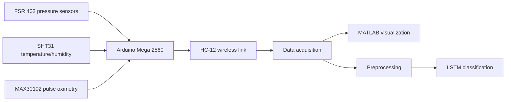

# Bachelor's Thesis: Wearable Smart Insole for Early Diabetic Foot Ulcer Prediction Using Multi-Modal Sensing

**BSc Electrical Engineering · Information Technology University of the Punjab (ITU), Lahore · 2025**

**Researchers:** Muhammad Nouman and Abdul Rahman  
**Supervisor:** Prof. Dr. Muhammad Qasim Mehmood  
**Co-supervisor:** Dr. Sadia Noureen

**[Published IEEE INMIC 2025 paper](https://doi.org/10.1109/INMIC65900.2025.11348422)**

> **Thesis PDF and poster:** The repository documentation page is live. The full files will be linked here after the approved thesis and poster have been uploaded. This project is an exploratory research prototype, not a clinically validated medical device.

## Research overview

Our final-year project examined a wearable smart insole for monitoring physical measurements relevant to diabetic foot health. The prototype integrates plantar pressure, temperature and humidity, and pulse-oximetry sensing; wireless data acquisition; MATLAB-based visualization; and an experimental LSTM classifier.

The work involved hardware prototyping, signal acquisition, time-series analysis and machine-learning evaluation.

## Architecture

## Components and methodology

- Six FSR 402 pressure sensors for plantar pressure measurements.
- Two SHT31 temperature/humidity sensors and a MAX30102 pulse oximeter, as documented in the IEEE paper.
- Arduino Mega 2560 and HC-12 communication for the prototype.
- Preprocessing and visualization of sensor time series, including foot-pressure mapping.
- LSTM-based experimental risk-category classification.
- Custom wearable housing and 3D-printed mechanical components.

## Evaluation reported in the research documents

| Measure | Reported source |
| --- | --- |
| 22 study participants | IEEE INMIC 2025 paper |
| 92% classification test accuracy | Bachelor's thesis, Chapter 6.6 |
| 94–96% classification accuracy | IEEE INMIC 2025 paper, Section 4.4 |

These reported figures reflect different source descriptions/evaluations; they should not be combined into a single performance estimate. The supplied reports do not establish independent external clinical validation.

## Thesis and related materials

The bachelor's thesis examines the research motivation, multimodal sensing architecture, sensor mapping, signal preprocessing, LSTM methodology and prototype results. The associated poster summarizes the hardware and results. The final approved thesis PDF and poster will be linked here when the documents are cleared and uploaded.

**Publication:** M. Nouman and A. Rahman, “Wearable Smart Insole for Early Diabetic Foot Ulcer Prediction Using Multi-Modal Sensing,” *2025 27th International Multitopic Conference (INMIC)*. [DOI: 10.1109/INMIC65900.2025.11348422](https://doi.org/10.1109/INMIC65900.2025.11348422).

**Research limitations:** Limited participant study, no documented external clinical validation. Raw patient or participant records will not be made publicly available.

**Acknowledgments:** Department of Electrical Engineering, ITU; Prof. Dr. Muhammad Qasim Mehmood and Dr. Sadia Noureen. Both project authors are credited.
